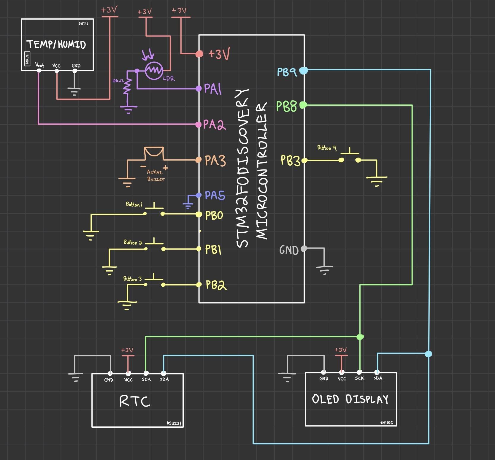

# STM32F0 Digital Clock
## Project Summary

The STM32F0 Digital Clock is a bare-metal, modular embedded systems project designed and implemented on the STM32F051R8 microcontroller. The system coordinates multiple hardware peripherals across dedicated communication buses to deliver high-precision real-time timekeeping, environmental telemetry, non-blocking daily alarm scheduling, and closed-loop ambient light adaptation.

## Technical Specifications

- **Development Board**: STM32F0DISCOVERY

- **Microcontroller**: STM32F051R8T6 (ARM Cortex-M0)

- **Toolchain**: GNU Arm Embedded Toolchain (arm-none-eabi-gcc), CMake, Ninja, ST-LINK / OpenOCD

- **Language**: Embedded C

- **Status**: In Progress

## Development Environment & Toolchain Setup

The project uses a cross-platform, command-line-driven embedded development environment centered around **Visual Studio Code**, configured to cross-compile for ARM Cortex-M targets.

### Prerequisites & Toolchain Dependencies

Ensure the following tools are installed and present in your system's executable path (`PATH`):

- **Cross-Compiler**: [GNU Arm Embedded Toolchain](https://developer.arm.com/downloads/-/gnu-rm) (`arm-none-eabi-gcc`, `arm-none-eabi-gdb`, `arm-none-eabi-objcopy`)
  - Target Architecture: `ARM Cortex-M0` (flags: `-mcpu=cortex-m0 -mthumb`)
- **Build System Generator**: [CMake](https://cmake.org/) (Version 3.22 or newer)
- **Underlying Build Engine**: [Ninja](https://ninja-build.org/) (Recommended for ultra-fast incremental builds) or `make`
- **In-Circuit Debugger & GDB Server**: [OpenOCD](https://openocd.org/) (Open On-Chip Debugger) or ST-LINK Utilities
- **Hardware Flashing Interface**: Integrated ST-LINK/V2 on the STM32F0DISCOVERY board

#### macOS Installation (via Homebrew):
```bash
brew install cmake ninja openocd
brew install --cask gcc-arm-embedded
```
 
### Recommended VS Code Extensions

- **C/C++ (ms-vscode.cpptools)**: IntelliSense, symbol navigation, and syntax highlighting.

- **CMake Tools (ms-vscode.cmake-tools)**: Configures and runs CMake targets directly from the editor status bar.

- **Cortex-Debug (marus25.cortex-debug)**: Provides advanced register viewers, peripheral inspection (SVD), and breakpoints via OpenOCD/GDB.

### VS Code Configuration Files

To automate building and in-circuit debugging, create a `.vscode/` directory in the repository root with the following JSON configurations:

`launch.json` (OpenOCD GDB In-Circuit Debugging)

```bash
{
  "version": "0.2.0",
  "configurations": [
    {
      "name": "Debug STM32F0 (OpenOCD)",
      "type": "cortex-debug",
      "request": "launch",
      "servertype": "openocd",
      "cwd": "${workspaceFolder}/firmware",
      "executable": "${workspaceFolder}/firmware/build/Debug/firmware.elf",
      "device": "STM32F051R8",
      "configFiles": [
        "board/stm32f0discovery.cfg"
      ],
      "armToolchainPath": "/opt/homebrew/bin",
      "runToEntryPoint": "main"
    }
  ]
}
```

`settings.json` (Workspace Path & CMake Setup)
```bash
{
  "cmake.sourceDirectory": "${workspaceFolder}/firmware",
  "cmake.buildDirectory": "${workspaceFolder}/firmware/build",
  "cmake.environment": {
    "PATH": "/opt/homebrew/bin:${env:PATH}"
  }
}
```

`tasks.json` (Target Flashing Task)
```bash
{
  "version": "2.0.0",
  "tasks": [
    {
      "label": "Flash Firmware (OpenOCD)",
      "type": "shell",
      "command": "openocd -f board/stm32f0discovery.cfg -c 'program ${workspaceFolder}/firmware/build/Debug/firmware.elf verify reset exit'",
      "problemMatcher": [],
      "group": {
        "kind": "build",
        "isDefault": false
      }
    }
  ]
}
```

## Components

1. Development Board (1)
    - STM32F0DISCOVERY
2. Solderless Breadboard (1)
    - Twin Industries
3. Jumper Wires (Multiple)
    - Generic M-F Jumper Wires
4. Real-Time Clock Module (RTC) (1)
    - Adafruit DS3231 Precision RTC - STEMMA QT
5. OLED Display (1)
    - AITRIP 1.3” SH1106 I2C OLED
6. Temperature/Humidity Sensor Module (1)
    - Generic DHT11 Sensor
7. Active Buzzer (1)
    - Generic Active Buzzer
8. Tactile Push Buttons (4)
    - PTS636SK43 LFS C&K Tactile Switch
9. Photoresistor (LDR)
    - Generic LDR
10. 10kΩ Resistor (1)
    - Generic 10kΩ Resistor

## Pinout & Bus Mapping

* **PB8 (I2C1_SCL)**
    - Alternate Function 1 (AF1), Open-Drain. Shared I2C clock line communicating with both the DS3231 RTC and SH1106 OLED panel
* **PB9 (I2C1_SDA)**
    - Alternate Function 1 (AF1), Open-Drain. Shared I2C bidirectional data line communicating with both the DS3231 RTC and SH1106 OLED panel
* **PA1 (ADC_IN1)**
    - Analog Mode. Single-channel 12-bit ADC input connected to the LDR photoresistor voltage divider to read ambient lighting conditions
* **PA2 (GPIO)**
    - Bidirectional GPIO (toggled between Open-Drain/Output and Input). Single-wire communication bus interfacing with the DHT11 sensor
* **PA3 (GPIO)**
    - Push-Pull Digital Output, Low-Speed. Drives the active piezo buzzer for alarm tones and button chirps
* **PB0 (GPIO)**
    - Digital Input with Internal Pull-Up. Button 1: Mode cycle / Advance edit field
* **PB1 (GPIO)**
    - Digital Input with Internal Pull-Up. Button 2: Increment selected field (+1) / Toggle alarm state
* **PB2 (GPIO)**
    - Digital Input with Internal Pull-Up. Button 3: Decrement selected field (-1) / Toggle alarm state
* **PB3 (GPIO)**
    - Digital Input with Internal Pull-Up. Button 4: Save settings to RTC/Alarm / Tactile chirp / Silence alarm
* **PC8 (GPIO)**
    - Push-Pull Output. Diagnostic Blue LED (flashes rapidly if I2C bus initialization fails)
* **PC9 (GPIO)**
    - Push-Pull Output. Diagnostic Green LED (flashes 5 times rapidly on boot when both I2C peripherals respond with ACK)

## Circuit Diagram



The breadboard prototype connects all sensors, display peripherals, and user inputs to a central STM32F0 breakout board. 
Power is distributed across a regulated 3.3V logic and power rail.

* **I2C Bus Architecture**: The DS3231 real-time clock and SH1106 OLED display reside on the same physical I2C1 bus lines (PB8 and PB9). 
Bus contention is prevented by fixed hardware address assignments: 0x68 for the RTC and 0x3C for the OLED display. 
Both lines operate in open-drain configuration with pull-up termination.

* **Single-Wire Handshake Architecture**: The DHT11 communication line on PA2 acts bidirectionally. 
The STM32 initially commands the line low for 18 milliseconds to signal a transmission start, releases the line, switches to input mode, and samples 
40 microsecond-spaced pulses to decode humidity, temperature, and checksum bytes.

* **Analog Front-End**: The LDR and a 10 k precision fixed resistor form a voltage divider outputting an analog voltage directly proportional to room lux levels. 
This voltage is read by the internal 12-bit ADC (ADC_IN1), yielding digital values ranging from 0 (pitch darkness) to 4095 (maximum saturation).

## System Features

1) **Continuous Real-Time Clock & Calendar**:

Polls the DS3231 RTC once every second during active clock mode using burst register reads. 
Time and date registers are converted from Binary-Coded Decimal (BCD) into standard integers.

2) **Algorithmic Day-of-Week Calculation (Sakamoto’s Method)**:

Uses an integer-only variation of Zeller’s Congruence to calculate the day of the week from the current month, day, and year. 
The calculated index maps to a 3-letter weekday string (SUN, MON, TUE, WED, THU, FRI, SAT), eliminating floating-point math libraries and reducing flash footprint.

3) **Custom OLED Rendering**:

The 128x64 pixel SH1106 display is controlled via an internal 8-page memory buffer. 
A custom 7x10 monospace ASCII font table renders centered time, date, and climate lines, and includes extended character byte mapping at ASCII 0x7F 
for a superscript degree symbol (°).

4) **Single-Wire Climate Telemetry**:

Samples the DHT11 sensor every 2 seconds. 
The driver captures microsecond timings using the core SysTick timer, parses the 40-bit data packet, verifies the checksum byte, and converts Celsius readings 
into Fahrenheit for display.

5) **Dynamic Contrast Scaling & Auto Screen Blanking**:

Samples the LDR via ADC1 every 20 milliseconds. 
The system maps ambient lux levels into three contrast tiers (0x00, 0x50, 0xFF), only transmitting I2C contrast updates when a tier threshold is crossed. 
If darkness (adc_val < 800) persists continuously for 30 seconds, the display sends command 0xAE to enter low-power sleep mode, waking immediately via 
command 0xAF when room light returns or any button is pressed.

6) **Daily Recurring Alarm Daemon**:

Includes a non-blocking background daemon that compares current time against configured alarm settings. 
When triggered, the buzzer pulses in an audible pattern (150 ms ON, 150 ms OFF) using HAL_GetTick() intervals, keeping the main loop active. 
If the display is sleeping when the alarm fires, it powers back on automatically. 
Pressing any button silences the alarm while keeping it armed for the next day.

## UI Navigation & Menu State Flow

The UI subsystem isolates menu navigation and visual rendering from low-level hardware sampling. 
Pressing Button 1 (PB0) transitions the clock through configuration states:

### UI_STATE_CLOCK (Default Running Mode)
- Displays Hours:Minutes:Seconds (with an asterisk * if the alarm is armed)
- Displays Day-of-Week and Month/Day/Year
- Displays Temperature (°F) and Relative Humidity (%RH)
- Button 1 transitions to UI_STATE_SET_HOURS

### Time & Date Configuration Sequence ([SET TIME] Screen)
- `UI_STATE_SET_HOURS`: Blinks hour digits; modified using Button 2 (+1) or Button 3 (-1)
- `UI_STATE_SET_MINUTES`: Blinks minute digits; modified using Button 2 or Button 3
- `UI_STATE_SET_MONTH`: Blinks month digits; modified using Button 2 or Button 3
- `UI_STATE_SET_DAY`: Blinks day digits; modified using Button 2 or Button 3
- `UI_STATE_SET_YEAR`: Blinks year digits; modified using Button 2 or Button 3

### Alarm Configuration Sequence ([SET ALARM] Screen)
- `UI_STATE_SET_ALARM_HOURS`: Displays ALM: HH:MM; blinks alarm hour digits; modified using Button 2 or Button 3
- `UI_STATE_SET_ALARM_MINUTES`: Blinks alarm minute digits; modified using Button 2 or Button 3
- `UI_STATE_SET_ALARM_ENABLE`: Displays STATE: ON  / STATE: OFF; blinks state text; toggled using Button 2 or Button 3
- Pressing Button 1 wraps back to UI_STATE_SET_HOURS

### Saving & Exit:

- Pressing Button 4 (PB3) from any configuration state commits all time/date updates to the DS3231 RTC, saves alarm parameters, 
sounds a 60 ms confirmation chirp, and returns to UI_STATE_CLOCK

## Switch Debounce & Edge-Detection Pipeline

Mechanical contact bounce is filtered through an active-low software edge-detection pipeline running inside the 20 millisecond main loop:

- **Raw Level Polling**: Reads physical pin levels (PB0–PB3). Unpressed buttons register logic 1 (via internal pull-ups); 
pressed buttons pull the line to logic 0 (GND)

- **Falling-Edge Evaluation**: Compares the current raw sample against the previous loop sample:$$\text{Pressed Event} = (\text{Previous State} == 1) \land (\text{Current State} == 0)$$

- **Event Dispatch**: A detected edge triggers an event flag (btnX_pressed = 1), dispatched to UI_ProcessButtons()

- **History Update**: Sets $\text{Previous State} = \text{Current State}$ for the next cycle, ensuring hold-down states do not trigger repeat clicks

## Firmware Codebase Organization

* **`main.h`**: Central application header that exports global HAL handles, system-wide pin definitions, and shared peripheral error macros

* **`main.c`**: Coordinates peripheral initialization, system clock configuration, falling-edge button polling, dynamic ADC contrast adjustments, screen sleep/standby control, and the primary application control loop

* **`ui.h`**: Declares the UI state machine enumerations, alarm configuration structure, and public API prototypes for menu navigation, screen rendering, and alarm cadence servicing

* **`ui.c`**: Implements the debounced multi-state menu subsystem, field-blinking cursor, Sakamoto day-of-week calculation, display string formatting, and non-blocking alarm buzzer cadence

* **`dht11.h`**: Defines the single-wire GPIO pin mapping, climate data structure, microsecond timing thresholds, and status return codes for the DHT11 sensor

* **`dht11.c`**: Implements the single-wire protocol, managing host start pulses, bus line-turnaround, SysTick microsecond bit sampling, and checksum parity validation for ambient temperature and humidity readings

* **`ds3231.h`**: Defines the hardware I2C address, register definitions, timestamp data structure, and public API prototypes for the DS3231 real-time clock driver

* **`ds3231.c`**: Implements low-level I2C read and write operations, BCD-to-decimal data conversions, and timekeeping configuration functions for the DS3231 RTC

* **`sh1106.h`**: Declares the display geometry, color definitions, command opcodes, contrast macros, and public drawing functions for the SH1106 OLED display driver

* **`sh1106.c`**: Manages the 1 KB internal RAM framebuffer, display controller startup initialization, page-based I2C screen refreshing, and coordinates pixel/string drawing routines

* **`fonts.h`**: Defines the font descriptor structure type and exports external references to available bitmap font glyph tables

* **`fonts.c`**: Stores the raw ASCII bitmap glyph matrix arrays, including the custom degree symbol (°), used by the display driver to render readable characters on screen

* **`adc.h`**: Declares the ADC peripheral handle (hadc) and the initialization function prototype for analog-to-digital conversions

* **`adc.c`**: Configures the hardware clock, internal calibration, conversion resolution, alignment, and sampling channel settings for the 12-bit ADC1 peripheral on PA1

* **`i2c.h`**: Declares the I2C peripheral handle (hi2c1) and the initialization function prototype for serial bus communication

* **`i2c.c`**: Initializes the I2C1 peripheral hardware, configuring bus clock timing, addressing mode, and physical pin mappings (PB8/PB9)

* **`gpio.h`**: Declares the initialization function prototype for configuring general-purpose input and output pins

* **`gpio.c`**: Configures and initializes the microcontroller’s GPIO port clocks, push-pull outputs, and pull-up input pins